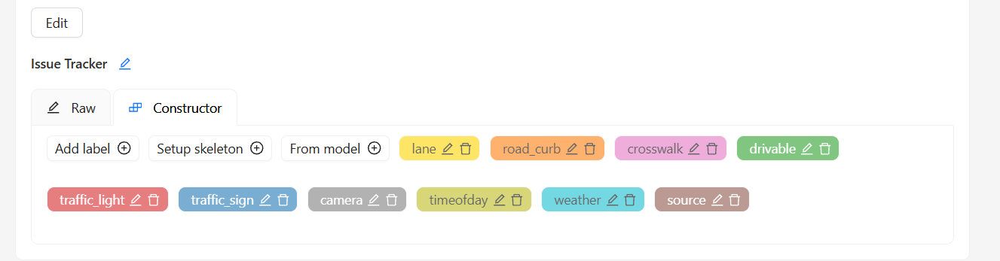
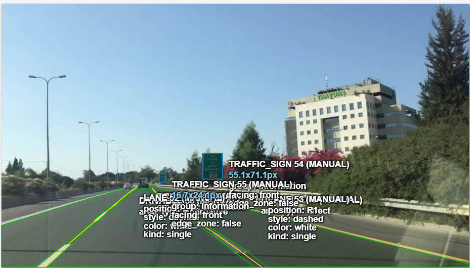
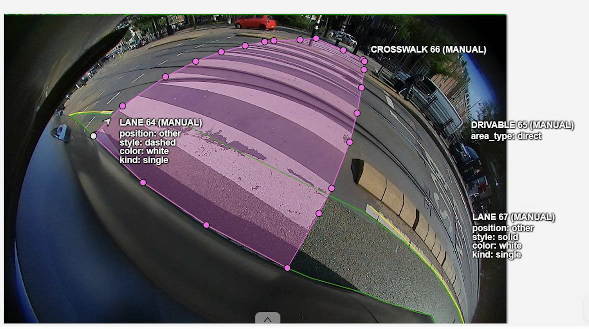

# Báo cáo cá nhân — Ngày 11
Họ tên: Huỳnh Ngọc Gia Hân               Mã học viên: 2A202603128
Phiên bản CVAT (Help → About): 2.74.1 (CVAT chạy local, http://localhost:8080)
Guideline: Road v1.0    Lần nộp (`revision` trong manifest): 3
Thời điểm export (ngày giờ trên CVAT): 21/11/2026, bản nộp revision 3: front 09:14 UTC (`<dumped>` trong XML); fisheye export 05:38 UTC, các sửa revision 2–3 (B03, B04, B08) chỉnh trực tiếp trong XML nên file không còn khối `<meta>`; hai zip đóng gói 09:41 UTC    Số lần nộp lại sau Rework: 2 (revision 2, 09:27 UTC; revision 3, 09:41 UTC, 21/11/2026)

## 1. Kiểm project
| Mục | Đúng như guideline Road v1.0? | Ghi chú |
| --- | --- | --- |
| 6 label, đúng kiểu | Có | lane, road_curb (polyline); crosswalk, drivable (polygon); traffic_light, traffic_sign (rectangle). Dán từ `configs/road_v1_labels.json` vào tab Raw |
| Thuộc tính và giá trị | Có | So với `python -m road_lab.taxonomy`: khớp |
| 4 tag ảnh | Có | camera, timeofday, weather, source; mỗi tag một thuộc tính select `value` |
Cách kết thúc polyline trên bản CVAT này: bấm phím **N** (hoặc nút Done) sau điểm cuối.
Cách đặt tag ảnh trên bản CVAT này: công cụ Tag ở thanh trái → chọn label → mở Details để chọn `value`. CVAT tự điền giá trị đầu danh sách (camera = front, weather = clear) nên phải kiểm lại từng tag.

## 2. Số lượng đã gán
| Task | Ảnh | lane | road_curb | crosswalk | drivable | traffic_light | traffic_sign |
| --- | ---: | ---: | ---: | ---: | ---: | ---: | ---: |
| front | 12 | 32 | 6 | 5 | 24 | 31 | 31 |
| front-extra (đã làm 4 / 4) | 4 | 12 | 0 | 4 | 9 | 10 | 12 |
| fisheye | 8 | 9 | 7 | 9 | 11 | 6 | 5 |
| fisheye-extra (đã làm 3 / 4) | 4 | 0 | 4 | 4 | 3 | 0 | 0 |

Số liệu theo bản nộp revision 3. B11 (bãi đỗ xe, camera sau) chỉ có 4 tag, chưa gán shape.

## 3. Bảng ca khó
| Ảnh | Nhãn | Phân vân giữa | Đã chọn | Lý do |
| --- | --- | --- | --- | --- |
| A05 | lane | Vẽ L1/R1 ước lượng / không vẽ | Không vẽ lane, chỉ road_curb | Đường không có vạch sơn; guideline: không tự vẽ vạch. Lint báo QC1-02, đã nhờ coach xác nhận miễn |
| A05 | drivable | Cả bề ngang đường / nửa phải | Nửa phải (direct) | Đường hai chiều không vạch giữa. Bản nộp còn gồm phần dải đỗ xe trống trước SUV đen, chưa cắt theo quy tắc mới |
| A09 | lane R1 | Vẽ R1 / road_curb | road_curb | Bên phải không có vạch sơn, chỉ có mép vỉa hè; lint báo thiếu R1, đã nhờ coach xác nhận |
| A06 | traffic_light (đèn đi bộ) | green / unknown | green | Hình người đi bộ sáng màu trắng; danh sách color không có "white", chọn màu ứng với nghĩa "được đi" |
| A06 | timeofday, weather | dusk / day; clear / overcast | day, clear | Trời trắng xám dưới gầm cầu, khó phân biệt; giữ theo cảm nhận lúc gán |
| A11 | timeofday | night / dusk | night | Trời xanh thẫm, đèn đã bật; ranh giới chạng vạng và đêm không rõ |
| B03, B04 | lane | Vẽ từ mép dưới / từ chân trời | Từ mép dưới gần xe (đã sửa ở revision 2) | Camera sau: lúc gán chưa rõ "gần xe" là phía nào trên ảnh; đúng ra phải bắt đầu ở mép dưới gần thân xe |
| A15 | lane | L1 / L2 cho vạch ngoài cùng bên trái | L2 (đã sửa ở revision 2) | Lỡ để giá trị mặc định; lint báo 2 polyline cùng L1. Vạch thứ hai tính từ xe nên là L2 |

## 4. Phiếu QC 1 nhận được
Bạn kiểm lô của tôi: Lương Văn Quyến  Quyết định nhận được: **Rework** (8 lỗi chính / 67 nhãn = 11,9 % > 5 %; 0 lỗi nặng sau khi coach miễn QC1-02 ở A05, A09)

Phiếu chỉ ghi tổng 8 lỗi chính kèm mô tả, không ghi số lỗi riêng cho từng mã, nên bảng dưới liệt kê theo từng lỗi được nêu.

| Mã lỗi | Số lỗi | Đồng ý? | Đã sửa? |
| --- | ---: | --- | --- |
| QC1-12 bàn giao: `huynhngocgiahan-front.zip` lệch SHA-256 so với manifest, chỉ có 12/16 ảnh (thiếu A13–A16) | 1 (ngoài 8 lỗi chính) | Đồng ý: file front gửi đi là bản export CVAT chưa gộp front-extra | Đã sửa: gộp A13–A16 vào `huynhngocgiahan-front.zip` (16 ảnh), manifest mới revision 2 khớp SHA-256; bản cũ cất ở `r1/` |
| QC1-07 A07, A10: polygon drivable khoét theo xe | trong 8 | Đồng ý: polygon `direct` có các điểm vòng quanh xe phía trước, trái quy tắc "không khoét lỗ" | Đã sửa qua hai lần: revision 2 bỏ các điểm ôm quanh bánh và hông xe; revision 3 kéo polygon tới cuối làn, trùm qua xe (xem bảng QC lần 2 bên dưới) |
| QC1-08 A07, A10: thiếu hộp đèn | trong 8 | Đồng ý: bản nộp không có `traffic_light` nào ở A07, A10 | Đã sửa: A07 thêm 3 hộp đèn xanh (đổi màu từ giá trị mặc định red sang green), A10 thêm hộp đèn đỏ |
| QC1-04 B03: vạch lệch tâm | trong 8 | Đồng ý: lane B03 còn vẽ từ xa về gần (đã ghi ở bảng ca khó) | Đã sửa: L1 vẽ lại từ gần ra xa trên tâm các vệt sơn thấy được, dừng ở vệt gần nhất (đoạn gần xe không có vệt sơn, vệt trong bóng là vạch ngang giao lộ); L2 đảo chiều. Cùng lỗi chiều vẽ ở B04 R1 cũng đã đảo |
| QC1-09 B03: biển hiệu lệnh gán sai nhóm | trong 8 | Đồng ý | Đã sửa: biển tròn xanh mũi tên (1130,362) prohibitory → mandatory |
| QC1-07 B08: vùng lái lấn vào viền tối | trong 8 | Đồng ý | Đã sửa: cắt mũi dưới trái của polygon `direct`, dừng ở mép thân xe và mép viền tối (y ≈ 888) |
| QC1-11 B03: `edge_zone` sát ngưỡng (người kiểm chưa tính vào 8 lỗi) | 0 | Đồng ý: lint cũng gợi ý bật `edge_zone` | Đã sửa: bật `edge_zone` cho biển (1130,362) |
| QC1-02 A05, A09: thiếu L1/R1 | 0 | Đồng ý: coach đã xác nhận ảnh không thấy vạch, miễn | Không cần |

Lần nộp lại (revision 2) theo phiếu QC 1 của Lương Văn Quyến: hai zip giữ nguyên tên, manifest `huynhngocgiahan-manifest.json` revision 2; bản revision 1 ở `r1/`. Ngoài các lỗi trong phiếu, sửa thêm các cảnh báo lint còn lại: A15 vạch ngoài cùng bên trái L1 → L2 (hết trùng L1); xoá điểm lặp ở A02, A14, A16. `lint` sau khi sửa: 3 nặng (QC1-02 ở A05, A09, coach đã miễn), 0 chính, 3 nhẹ (box < 8 px, không bắt buộc).

**QC lại revision 2 (Lương Văn Quyến): Rework, 4 lỗi chính / 72 nhãn = 5,6 %, 0 lỗi nặng.** Các lỗi đèn A07, A10, nhóm biển B03 và vùng lái B08 được xác nhận đã xử lý. Lỗi còn lại và cách sửa ở revision 3:

| Ảnh | Lỗi còn lại (QC lần 2) | Đồng ý? | Đã sửa ở revision 3 |
| --- | --- | --- | --- |
| A07 | QC1-07 drivable#6 vẫn cắt vùng lái tại đuôi xe bạc | Đồng ý: cạnh trên của polygon `direct` dừng ở đuôi xe (y ≈ 360), vẫn là khoét theo xe | Kéo polygon tới cuối làn (y ≈ 269) theo chân dải phân cách bên trái và R1 bên phải |
| A10 | QC1-07 drivable#13 cắt vùng lái theo xe Subaru | Đồng ý | Polygon `direct` kéo tới y ≈ 300, giữa L1 và R1 |
| A10 | QC1-07 drivable#12 cắt vùng lái theo xe Acura và xe đỗ | Đồng ý | Polygon `alternative`: mép trái đi theo R1 tới y ≈ 300, cạnh trên nối thẳng sang góc phải, không đi theo đuôi xe nữa |
| B03 | QC1-04 lane#0 bỏ đoạn vạch gần (920, 590) | Đồng ý: ở revision 2 tôi nhận nhầm vệt này là mũi tên. Thực ra đó là vệt đứt gần xe, bị fisheye kéo dài | L1 vẽ từ vệt gần (957,631)–(893,552), nối qua khoảng trống tới các vệt xa; đường chia `direct`/`alternative` đi theo L1 mới tới mép thân xe |

Bài học: "đi được nếu đường trống" nghĩa là polygon phải đi tới cuối đoạn đường thấy được, không chỉ không khoét lỗ mà còn không dừng ở đuôi xe phía trước. Bản revision 2 cất ở `r2/` (manifest đổi tên `huynhngocgiahan-manifest-r2.json`). `lint` revision 3: 3 nặng (QC1-02 A05, A09, coach đã miễn), 0 chính, 3 nhẹ.

**QC lại revision 3 (Lương Văn Quyến): Release.** 0 lỗi nặng, 0 lỗi chính trên 72 nhãn (6 ảnh mẫu đối chiếu với ảnh gốc). Cả 4 lỗi của revision 2 được xác nhận đã xử lý: vùng lái A07, A10 đã nối qua phần đường bị xe che; lane#0 B03 đã nối đoạn vạch gần và xa theo cung. Hai zip mở được, đủ 28 ảnh, khớp SHA-256 trong manifest. Sáu cảnh báo lint còn lại: ba ca thiếu vạch (A05, A09) coach đã miễn, ba hộp dưới 8 px thuộc diện tùy chọn.

Lỗi đã tự sửa trước khi nộp (sau self-QC và lint):
- A01: L1/R1 bị đảo, vạch đứt bên phải xe ghi L1 (QC1-03, nặng) → đổi thành R1 / dashed.
- A07: vạch bên phải xe tải ghi L2 (QC1-03, nặng) → đổi thành R2.
- B01: tag camera = front (QC1-01, nặng) → fisheye_front.
- A02: L2/R1 đang để mặc định L1/solid (QC1-03, QC1-06) → sửa đúng position và style.

## 5. Kiểm file export
| File | Mở lại được? | Số shape ảnh 1 (job / file) | Số shape ảnh 2 (job / file) | Tag camera có trong XML? |
| --- | --- | --- | --- | --- |
| huynhngocgiahan-front.zip | Có (`road_check lint`) | A01: 8 / 8 | A02: 5 / 5 | Có (front) |
| huynhngocgiahan-fisheye.zip | Có (`road_check lint`) | B01: 4 / 4 | B02: 8 / 8 | Có (fisheye_front …) |

`lint` lần cuối (revision 3): 28 ảnh, 3 nặng (QC1-02 ở A05, A09: coach miễn), 0 chính, 3 nhẹ (box đèn/biển dưới 8 px ở A07 ×2, A10: không bắt buộc). Manifest `huynhngocgiahan-manifest.json`: revision 3, SHA-256 khớp cả hai zip, `contains_images = false` cho cả hai file.

## 6. Ảnh chụp màn hình
1. Tab Labels của project `d11-road-han`.

   

2. Một ảnh camera trước đã gán đủ (làn, vùng lái, đèn/biển): A01.

   

3. Một ảnh fisheye đã gán, phóng to đoạn polyline cong: B06 (camera gương trái), hai lane `position: other` cong theo méo fisheye, crosswalk và drivable `direct`.

   

4. Một đoạn XML có `<polyline label="lane">` (B03, lane L1 trong `huynhngocgiahan-fisheye.zip`, revision 3: vẽ từ gần thân xe ra xa theo cung; `points` được xuống dòng cho dễ đọc, trong file là một dòng):

   ```xml
   <polyline label="lane" source="manual" occluded="0" z_order="0"
             points="957.00,631.00;931.00,603.00;910.00,582.00;893.00,553.00;
                     872.00,510.00;850.00,465.00;826.00,420.00;803.00,385.00;
                     782.00,357.00;770.00,349.00;758.00,341.00;716.00,310.00;
                     709.00,305.00;690.00,293.00">
     <attribute name="position">L1</attribute>
     <attribute name="style">dashed</attribute>
     <attribute name="color">white</attribute>
     <attribute name="kind">single</attribute>
   </polyline>
   ```

## 7. Tự đánh giá
Lỗi bạn mắc nhiều nhất hôm nay (theo mã QC1-xx), và cách tránh ở Ngày 20: QC1-03 (sai `position`). CVAT điền sẵn `L1 / solid / white / single` cho mọi polyline mới, nên ở A01, A02, A07 tôi để nhầm L1 cho vạch bên phải hoặc vạch ngoài. Ngày 20: vẽ xong vạch nào thì mở Details sửa ngay; tự hỏi "vạch nằm trái hay phải tâm ảnh, là vạch thứ mấy tính từ xe"; chạy `lint` sau mỗi vài ảnh để bắt "chưa có R1" hoặc "2 polyline cùng position".
Nhãn của bạn đi vào model ở đâu? Chọn một lỗi đã sửa và nói nó làm model học sai thế nào: nhãn `lane` có `position` là đích cho model phát hiện làn (ví dụ row-anchor), đầu ra của nó đi vào giữ làn (LKA). Ở A01 tôi đã đảo L1 và R1: nếu không sửa, model học rằng vạch bên phải xe là biên trái của làn đang đi, nên làn ego bị đặt lệch sang làn bên cạnh và hệ thống giữ làn sẽ lái xe về sai tâm làn.

## 8. (Tùy chọn, buffer) Từ polyline đến đích row-anchor
Vạch R1 ảnh A01 (`python -m road_lab.rowanchor huynhngocgiahan-front.zip --image A01 --position R1`):

| y | 720 | 680 | 640 | 600 | 560 |
| --- | ---: | ---: | ---: | ---: | ---: |
| x của chúng tôi | không có làn* | 656.5 | 600.3 | 544.1 | 487.9 |
| x của bạn kia |  |  |  |  |  |

\* Điểm đầu polyline ở y = 719.9, thấp hơn hàng 720 một chút nên script ghi "không có làn".

Trả lời 3 câu:

1. Polyline R1 kết thúc ở y ≈ 502. Dừng sớm 40 px ở đầu xa thì điểm cuối thành y ≈ 542, vẫn ở trên hàng 560, nên năm hàng không đổi. Nếu bỏ 40 px ở đầu gần xe thì điểm đầu thành y ≈ 680 và hàng 720 (đang sát mép) chắc chắn thành "không có làn"; mất phần gần xe là mất chính đoạn quan trọng nhất.
2. (Điền sau khi có lô của bạn được kiểm.) Lệch ở hàng 720 (gần xe) ảnh hưởng LKA nhiều hơn, vì đó là vị trí ngang của vạch ngay cạnh xe mà bộ điều khiển dùng để tính độ lệch tâm làn.
3. Phép nội suy x theo y cho cùng kết quả vì chỉ dựa vào tung độ. Nhưng `road_check` coi điểm đầu là điểm gần xe: nó báo QC1-04 "vẽ ngược chiều" và so điểm đầu/điểm cuối với GT sai đầu; `lint` cũng cảnh báo "điểm đầu cao hơn điểm cuối".
